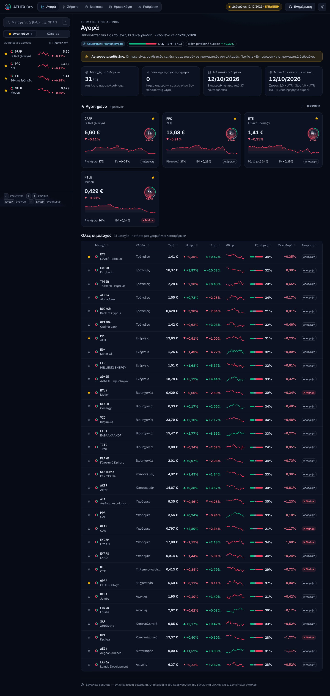
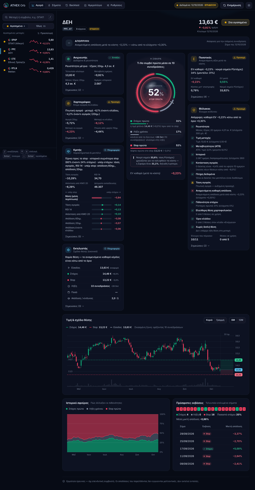
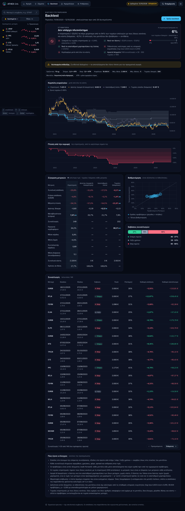
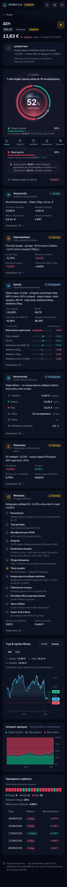
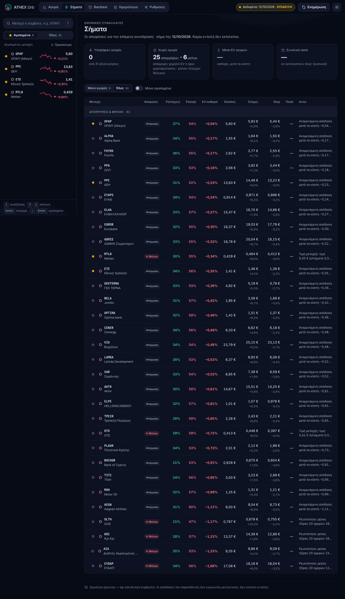
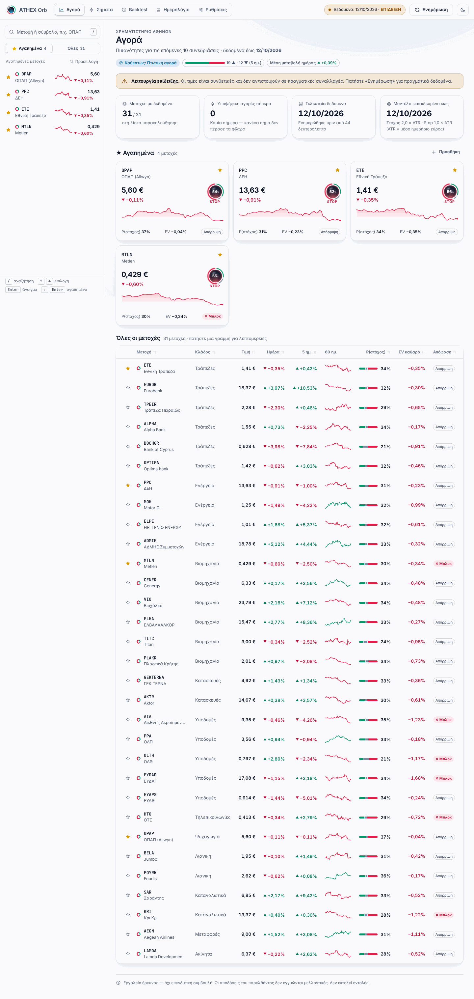
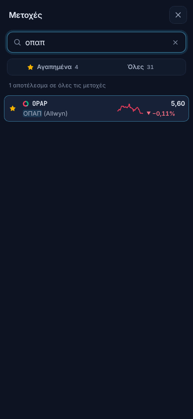

# ATHEX Orb

Εργαλείο **έρευνας, backtest και εικονικών συναλλαγών (paper trading)** για μετοχές του Χρηματιστηρίου Αθηνών.
Για κάθε μετοχή, η **Σφαίρα** απαντά σε ένα ερώτημα: *τι θα συμβεί πρώτα μέσα στις επόμενες 10 συνεδριάσεις;*
Δίνει τρεις πιθανότητες: **Στόχος πρώτα**, **Λήξη χρόνου** και **Stop πρώτα**. Γύρω της έξι «πράκτορες»
εξηγούν, με απλά ελληνικά, πώς φτάνει η εφαρμογή σε μια απόφαση.

> **Τι ΔΕΝ είναι.** Δεν είναι επενδυτική συμβουλή και δεν εκτελεί εντολές. Δεν συνδέεται με χρηματιστή·
> όλες οι «θέσεις» είναι εικονικές και καταγράφονται σε ένα τοπικό ημερολόγιο. Οι αποδόσεις του παρελθόντος
> δεν εγγυώνται τις μελλοντικές. Το backtest σας λέει καθαρά όταν δεν υπάρχει πλεονέκτημα, και αυτό είναι το
> πιο συνηθισμένο αποτέλεσμα.



| Μετοχή: η Σφαίρα και οι έξι πράκτορες | Backtest: ετυμηγορία και σύγκριση | Κινητό |
|---|---|---|
|  |  |  |

| Σήματα της ημέρας | Φωτεινό θέμα | Αναζήτηση στο κινητό |
|---|---|---|
|  |  |  |

Τα στιγμιότυπα δείχνουν **δεδομένα επίδειξης** (συνθετικές τιμές με την ένδειξη «ΕΠΙΔΕΙΞΗ»), όχι την πραγματική αγορά.

---

## Γρήγορη εκκίνηση

Χρειάζεστε Python 3.11 ή νεότερη.

```bash
git clone https://github.com/gifted13/-athex-orb.git athex-orb
cd athex-orb

python -m venv .venv
source .venv/bin/activate            # Windows: .venv\Scripts\activate
pip install -r requirements.txt

# Α. πραγματικά δεδομένα από το Yahoo Finance (χρειάζεται σύνδεση στο διαδίκτυο)
python -m athex_orb refresh

# Β. ή δεδομένα επίδειξης χωρίς διαδίκτυο (συνθετικά, ~20 δευτερόλεπτα, μαζί με backtest)
python -m athex_orb demo

python -m athex_orb serve            # → ανοίξτε http://127.0.0.1:8000
```

Μπορείτε να ξεκινήσετε και κατευθείαν με `serve`. Χωρίς δεδομένα, η πρώτη σελίδα προσφέρει δύο κουμπιά:
**«Λήψη πραγματικών δεδομένων»** και **«Δοκιμή με δεδομένα επίδειξης»**. Το backtest με πραγματικά δεδομένα
τρέχει με `python -m athex_orb backtest` ή με το κουμπί «Τρέξε backtest».

Όλες οι εντολές:

```
python -m athex_orb demo                     # δεδομένα επίδειξης + εκπαίδευση + σήματα + backtest
python -m athex_orb refresh                  # λήψη τιμών + εκπαίδευση + σήματα + ημερολόγιο
python -m athex_orb backtest [--runs 200]    # backtest με τις αποθηκευμένες προβλέψεις
python -m athex_orb serve [--port 8000]      # διακομιστής + UI
python -m athex_orb signals [--all]          # τα σήματα της τελευταίας ενημέρωσης στο τερματικό
python -m athex_orb journal                  # το ημερολόγιο εικονικών συναλλαγών
python -m athex_orb --data-dir /άλλος/φάκελος …   # άλλος φάκελος δεδομένων (προεπιλογή ./data)
```

Αν η θύρα 8000 χρησιμοποιείται ήδη, το `serve` το λέει και προτείνει άλλη (`--port 8001`).

---

## Πώς δουλεύει: η Σφαίρα και οι έξι πράκτορες

Κάθε απόφαση παίρνεται **στο κλείσιμο** μιας συνεδρίασης. Η είσοδος γίνεται στο **άνοιγμα της επόμενης**. Από
την τιμή εισόδου ορίζονται δύο όρια με βάση το **ATR**, δηλαδή το μέσο ημερήσιο εύρος τιμής των τελευταίων 14
συνεδριάσεων:

* **στόχος** = είσοδος × (1 + 2 × ATR/τιμή)
* **stop** = είσοδος × (1 − 1 × ATR/τιμή)
* **λήξη χρόνου**: αν δεν αγγιχτεί κανένα όριο μέσα σε 10 συνεδριάσεις, η θέση κλείνει στο κλείσιμο της 10ης.

Αν αγγιχτούν και τα δύο όρια την ίδια ημέρα, μετρά ως stop (συντηρητικά). Τα ίδια ακριβώς κριτήρια
χρησιμοποιούνται στις ετικέτες του μοντέλου, στο backtest και στο ημερολόγιο.

Η σελίδα κάθε μετοχής ακολουθεί τη σειρά των πρακτόρων:

1. **Ανιχνευτής** (δεδομένα και ρευστότητα). Κατεβάζει και καθαρίζει τις ημερήσιες τιμές και υπολογίζει τον
   μέσο τζίρο 20 ημερών. Δείχνει κενά στα δεδομένα και ημέρες χωρίς συναλλαγές.
2. **Χαρτογράφος** (αγορά και κλάδος). Βρίσκει το καθεστώς της αγοράς (ανοδική, πτωτική ή ουδέτερη, με βάση τον
   Γενικό Δείκτη και τον μέσο όρο 100 ημερών) και συγκρίνει τη μετοχή με την αγορά και με τον κλάδο της. Αν ο
   δείκτης λείπει ή δεν είναι ενημερωμένος, χρησιμοποιεί ισοσταθμικό δείκτη των μετοχών της λίστας και το λέει.
3. **Κριτής** (χαρακτηριστικά και μοντέλο). Ένα μοντέλο τριών καταστάσεων (προεπιλογή: λογιστική παλινδρόμηση)
   διαβάζει 19 χαρακτηριστικά, όπως αποδόσεις, RSI, απόσταση από κινητούς μέσους, όγκο και σχετική ισχύ. Από
   αυτά δίνει τις τρεις πιθανότητες της **Σφαίρας**. Η γραμμή «Βάση» στους παράγοντες δείχνει από πού ξεκινά το
   μοντέλο για μια μέση περίπτωση (τις ιστορικές συχνότητες). Οι υπόλοιποι παράγοντες δείχνουν πόσο τη
   μετατοπίζουν «υπέρ στόχου» ή «υπέρ stop».
4. **Ποσοτικός** (αναμενόμενη αξία). Μετατρέπει τις πιθανότητες σε **αναμενόμενη απόδοση μετά από όλα τα κόστη**:
   προμήθεια, χρεώσεις, φόρο, spread και επίδραση της εντολής στην τιμή, που μεγαλώνουν όσο πέφτει η ρευστότητα.
   Υπολογίζει και το **νεκρό σημείο**, δηλαδή την P(στόχος) που χρειάζεται για να καλυφθούν τα κόστη. Η Σφαίρα το
   δείχνει ως εγκοπή στο πράσινο τόξο.
5. **Φύλακας** (έλεγχοι κινδύνου). Μπλοκάρει μετοχές με χαμηλή ρευστότητα, πολύ χαμηλή τιμή, ακραία
   μεταβλητότητα, σύντομο ιστορικό ή ελλιπή δεδομένα, καθώς και κάθε νέα θέση μετά από απότομη πτώση της αγοράς
   (−8% σε 10 ημέρες). Απορρίπτει επίσης ό,τι έχει αναμενόμενη απόδοση κάτω από το όριο (προεπιλογή +0,30%) και
   τηρεί τα όρια του χαρτοφυλακίου: μέγιστες θέσεις, θέσεις ανά κλάδο, μία θέση ανά μετοχή.
6. **Εκτελεστής** (σχέδιο εικονικής θέσης). Για μια «υποψήφια αγορά» δίνει είσοδο, στόχο, stop, λήξη και ποσό. Το
   ποσό έχει ανώτατο όριο και δεν ξεπερνά το 1% του μέσου τζίρου. Δεν στέλνει ποτέ εντολή. Η απόφαση (αγορά,
   απόρριψη ή μπλοκ) καταγράφεται στο ημερολόγιο.

**Χωρίς ματιά στο μέλλον.** Τα χαρακτηριστικά της ημέρας t υπολογίζονται μόνο με δεδομένα έως και την t. Το μοντέλο
εκπαιδεύεται **walk‑forward**: ξαναεκπαιδεύεται περίπου κάθε μήνα και βλέπει μόνο αποτελέσματα που είχαν κριθεί
πριν από την ημερομηνία πρόβλεψης. Ο τζίρος (για ρευστότητα, μέγεθος θέσης και κόστη) υπολογίζεται με τις τιμές
της ίδιας ημέρας, όχι με τιμές που έχουν προσαρμοστεί αργότερα για μερίσματα.

---

## Πώς διαβάζεται η ετυμηγορία του backtest

Το backtest προσομοιώνει όλο το διαθέσιμο ιστορικό με τους ίδιους κανόνες, τα ίδια κόστη και τους ίδιους
ελέγχους. Η στρατηγική συγκρίνεται με τρία πράγματα:

* **200 τυχαίες στρατηγικές** με τους ίδιους κανόνες: ίδιες ημέρες, ίδιο πλήθος υποψηφίων, ίδια μεγέθη θέσης και
  κόστη, αλλά με τις προβλέψεις ανακατεμένες ανάμεσα στις μετοχές. Αν η στρατηγική δεν τις ξεπερνά καθαρά, οι
  προβλέψεις δεν προσθέτουν τίποτα.
* **Αγορά και διακράτηση του δείκτη.**
* **Αγορά και διακράτηση ενός ισοσταθμικού χαρτοφυλακίου της λίστας**, με τα ίδια δεδομένα και την ίδια
  μεροληψία επιβίωσης. Ο Γενικός Δείκτης του Yahoo είναι δείκτης τιμών, χωρίς μερίσματα. Μόνο του θα ήταν
  ευκολότερος αντίπαλος από τις μετοχές, που είναι προσαρμοσμένες για μερίσματα.

Η κάρτα «Ετυμηγορία» δείχνει κάθε κριτήριο με ✓ ή ✕. Το **«Υπάρχει ένδειξη πλεονεκτήματος»** εμφανίζεται μόνο
όταν ισχύουν όλα:

1. η στρατηγική ξεπερνά τις τυχαίες με **p ≤ 0,05** (περίπου το 95%) και υπάρχουν τουλάχιστον **100** τυχαίες
   εκτελέσεις·
2. νικά **και** τον δείκτη **και** το ισοσταθμικό χαρτοφυλάκιο·
3. οι πιθανότητες του μοντέλου εκτός δείγματος είναι **καλύτερες από τις σταθερές ιστορικές συχνότητες**
   (μικρότερο log-loss, με έλεγχο επαναδειγματοληψίας σε μπλοκ ημερομηνιών). Αυτό αποκλείει τις «νίκες» που
   οφείλονται σε τύχη ή σε διαφορετική έκθεση στην αγορά·
4. είναι κερδοφόρα μετά από όλα τα κόστη, με τουλάχιστον 30 συναλλαγές.

Τα άλλα δύο επίπεδα είναι το «Ασθενές, μη αποδεδειγμένο πλεονέκτημα» (κάποιες ενδείξεις, όχι απόδειξη) και το
«Δεν υπάρχει πλεονέκτημα». Στον πίνακα μετρικών, οι τιμές για τις «Τυχαίες» είναι ο διάμεσος κάθε μετρικής
ανάμεσα στις εκτελέσεις. Το γράφημα «Βαθμονόμηση» δείχνει αν μια πρόβλεψη «30%» πετυχαίνει πράγματι περίπου
στο 30% των περιπτώσεων.

Στα δεδομένα επίδειξης δεν υπάρχει κρυμμένο σήμα, οπότε το σωστό αποτέλεσμα είναι «δεν υπάρχει πλεονέκτημα».
Η τρέχουσα επίδειξη δίνει:

> Η στρατηγική (−25,8%) τα πήγε χειρότερα από το 94% των τυχαίων επιλογών με τους ίδιους κανόνες και κόστη
> (διάμεσος −8,1%). Οι επιλογές του μοντέλου δεν βοήθησαν — αντίθετα.

---

## Ρυθμίσεις (`config.toml`)

Οι προεπιλογές βρίσκονται στο `config.toml`, με σχόλια για κάθε τιμή. Τα ποσοστά γράφονται ως κλάσματα: 0.003
σημαίνει 0,3%.

| Ενότητα | Τι ρυθμίζει |
|---|---|
| `[data]` | `source = "yahoo"` ή `"csv"`, `history_years` (χρόνια ιστορικού), `index_ticker` (Γενικός Δείκτης, `GD.AT`) |
| `[barriers]` | `k_tp`, `k_sl` (στόχος και stop σε πολλαπλάσια του ATR), `horizon_days` (ορίζοντας), `atr_days` |
| `[model]` | `kind = "logreg"` ή `"hgb"`, ελάχιστο ιστορικό, συχνότητα επανεκπαίδευσης, παράθυρο εκπαίδευσης |
| `[costs]` | προμήθεια ανά πλευρά και ελάχιστη προμήθεια, χρεώσεις, φόρος πώλησης, βασικό spread, επίδραση στην τιμή |
| `[portfolio]` | κεφάλαιο, μέγιστο ποσό ανά θέση, μέγιστες θέσεις (συνολικά και ανά κλάδο), μέγιστο μέρος του τζίρου |
| `[guard]` | ελάχιστος τζίρος, ελάχιστη τιμή, μέγιστο ATR/τιμή, ελάχιστο ιστορικό, παύση σε πτώση αγοράς, ελάχιστο EV |
| `[backtest]` | πλήθος τυχαίων στρατηγικών (`random_runs`, τουλάχιστον 100 για ετυμηγορία) και σπόρος |
| `[server]` | διεύθυνση και θύρα του διακομιστή |

Τα περισσότερα αλλάζουν και από τη σελίδα **Ρυθμίσεις** του UI, με επεξήγηση για κάθε πεδίο. Οι αλλαγές σας
αποθηκεύονται στο `data/settings.json` και υπερισχύουν του `config.toml`. Μια λάθος ή κατεστραμμένη τιμή εκεί
αγνοείται χωρίς να σταματήσει η εφαρμογή. Οι αλλαγές σε φύλακα, κόστη και χαρτοφυλάκιο εφαρμόζονται αμέσως.
Οι αλλαγές σε στόχο, stop, ορίζοντα ή μοντέλο χρειάζονται νέα «Ενημέρωση» (επανεκπαίδευση).

**Δικά σας αρχεία CSV** (`source = "csv"`): τοποθετήστε ένα αρχείο ανά μετοχή στο `data/csv/<ΣΥΜΒΟΛΟ>.csv`, π.χ.
`OPAP.AT.csv` ή `OPAP.csv`. Για τον δείκτη το αρχείο είναι `GD.AT.csv`. Γίνονται δεκτά:

* κεφαλίδα `date,open,high,low,close,volume`, ή ελληνικές κεφαλίδες (Ημερομηνία, Άνοιγμα, Υψηλό, Χαμηλό,
  Κλείσιμο, Όγκος)·
* διαχωριστικό `,`, `;` ή tab, και δεκαδικό κόμμα όπως στο ελληνικό Excel (`1.234,56`)·
* ημερομηνίες ISO (`2024-01-02`) ή ημέρα/μήνας/έτος (`02/01/2024`, `02.01.2024`).

Γραμμές με μη έγκυρη ημερομηνία ή χωρίς κλείσιμο αγνοούνται, και το μήνυμα της ενημέρωσης λέει πόσες ήταν. Οι
τιμές πρέπει να είναι προσαρμοσμένες για splits, και το κλείσιμο × όγκος πρέπει να δίνει τον τζίρο της ημέρας.

---

## Μετοχές και αγαπημένα

* **Αναζήτηση** στην πλαϊνή λίστα (στο κινητό με το 🔍). Το πλήκτρο `/` εστιάζει την αναζήτηση. Δέχεται σύμβολο,
  ελληνικό ή λατινικό όνομα, ψευδώνυμο ή κλάδο, χωρίς τόνους: `οπαπ`, `opap`, `ΔΕΗ`, `ppc`, `τραπεζες`. Με `↑` και
  `↓` επιλέγετε, με `Enter` ανοίγετε τη μετοχή και με `Esc` καθαρίζετε την αναζήτηση.
* **Αγαπημένα (★)**: πατήστε το αστέρι σε οποιαδήποτε μετοχή, στη λίστα, στους πίνακες ή στη σελίδα της, ή
  `Shift+Enter` στην αναζήτηση. Τα αγαπημένα εμφανίζονται στην καρτέλα «★ Αγαπημένα» της λίστας και ως κάρτες με
  τη Σφαίρα τους στην «Αγορά». Στα «Σήματα» και στο «Ημερολόγιο» υπάρχει φίλτρο «Μόνο αγαπημένα». Αποθηκεύονται
  στο `data/favorites.json`.
* **Νέα μετοχή**: γράψτε το σύμβολό της με λατινικούς χαρακτήρες, π.χ. `INTEK` ή `INLOT`, και επιλέξτε «Προσθήκη».
  Η εφαρμογή κατεβάζει τα δεδομένα της (στην επίδειξη φτιάχνει συνθετικά), την προσθέτει στα αγαπημένα και
  υπολογίζει τη Σφαίρα της με το ήδη εκπαιδευμένο μοντέλο. Αποθηκεύεται στο `data/universe_custom.json`. Οι
  μετοχές που προσθέσατε εσείς αφαιρούνται από τη σελίδα τους. Όσο τρέχει μια ενημέρωση, νέα μετοχή δεν προστίθεται· δοκιμάστε μόλις ολοκληρωθεί.

---

## Ρουτίνα εικονικών συναλλαγών (paper trading)

1. **Κάθε εργάσιμη, μετά τις 17:30 ώρα Αθήνας** (αφού κλείσει η συνεδρίαση), τρέξτε `python -m athex_orb refresh`
   ή πατήστε «Ενημέρωση». Αν τρέξετε την ενημέρωση νωρίτερα, η μισή μπάρα της ημέρας που ακόμη διαπραγματεύεται
   αγνοείται: η απόφαση αφορά πάντα μια ολοκληρωμένη συνεδρίαση.
2. Δείτε τα **Σήματα**: «Αγορά» (υποψήφια εικονική θέση για το αυριανό άνοιγμα), «Απόρριψη» (χαμηλή αναμενόμενη
   απόδοση ή όριο χαρτοφυλακίου) ή «Μπλοκ» (έλεγχος του Φύλακα).
3. Το **Ημερολόγιο** καταγράφει κάθε απόφαση, ακόμη και τις απορρίψεις, και τις κρίνει αυτόματα με τις επόμενες
   ενημερώσεις: στόχος, stop ή λήξη, με το εκτιμώμενο κόστος. Με τον καιρό φαίνεται αν οι «αγορές» πετυχαίνουν
   συχνότερα από τις «απορρίψεις».
4. Οι αποφάσεις μιας ημέρας **κλειδώνουν** στις 10:00 της επόμενης εργάσιμης, όταν ξεκινά η συνεδρίαση εισόδου.
   Μετά από αυτή την ώρα, μια αλλαγή ρυθμίσεων ή μια νέα ενημέρωση δεν τις ξαναγράφει. Οι γρήγοροι
   επανυπολογισμοί μετά από αλλαγή ρυθμίσεων δεν γράφουν ποτέ στο ημερολόγιο.

Οι εγγραφές της επίδειξης κρατιούνται χωριστά από τις πραγματικές και μηδενίζονται κάθε φορά που
δημιουργούνται νέα δεδομένα επίδειξης.

---

## Περιορισμοί

* **Ποιότητα δεδομένων Yahoo.** Οι τιμές του Yahoo για το ΧΑ έχουν κενά, ημέρες χωρίς όγκο, μεταγενέστερες
  διορθώσεις και σύμβολα που αλλάζουν ή διαγράφονται. Ο Ανιχνευτής καθαρίζει ό,τι μπορεί και δείχνει
  προειδοποιήσεις, αλλά δεν αντικαθιστά επαγγελματική πηγή δεδομένων. Ο Γενικός Δείκτης (`GD.AT`) συχνά δεν
  κατεβαίνει· τότε χρησιμοποιείται ισοσταθμικός δείκτης της λίστας και η σχετική σημείωση εμφανίζεται παντού.
* **Μεροληψία επιβίωσης.** Η προεπιλεγμένη λίστα περιέχει εταιρείες που είναι εισηγμένες σήμερα. Όσες διαγράφηκαν,
  συγχωνεύθηκαν ή κατέρρευσαν τα προηγούμενα χρόνια λείπουν. Έτσι το παρελθόν φαίνεται καλύτερο απ' ό,τι ήταν,
  τόσο για τη στρατηγική όσο και για το ισοσταθμικό χαρτοφυλάκιο.
* **Μόνο ημερήσιες μπάρες.** Δεν υπάρχουν ενδοσυνεδριακά δεδομένα. Μέσα στην ημέρα δεν ξέρουμε τι αγγίχτηκε πρώτο,
  γι' αυτό όταν αγγίζονται και τα δύο όρια μετρά συντηρητικά ως stop. Η είσοδος υποτίθεται στην τιμή ανοίγματος.
* **Κόστη κατά προσέγγιση.** Spread και επίδραση στην τιμή εκτιμώνται από τον μέσο τζίρο, όχι από το βιβλίο
  προσφορών. Ελέγξτε προμήθειες και φόρους με τον χρηματιστή σας και την ισχύουσα νομοθεσία.
* **Προσαρμογή για μερίσματα.** Οι αποδόσεις υπολογίζονται με τιμές προσαρμοσμένες για μερίσματα και splits. Ο
  έλεγχος «ελάχιστη τιμή» γίνεται επίσης στην προσαρμοσμένη τιμή, που για παλιές ημερομηνίες είναι λίγο
  χαμηλότερη από την πραγματική τιμή εκείνης της ημέρας.
* **Η επίδειξη είναι συνθετική.** Ό,τι δείχνει δεν λέει τίποτα για την πραγματική αγορά.

---

## Δομή του έργου

```
athex_orb/
  config.py      ρυθμίσεις (config.toml + data/settings.json)
  universe.py    προεπιλεγμένες μετοχές, αναζήτηση, μετοχές χρήστη
  synthetic.py   συνθετικά δεδομένα (επίδειξη και tests)
  scout.py       Ανιχνευτής: λήψη (Yahoo/CSV), καθαρισμός, αποθήκευση τιμών
  market.py      Χαρτογράφος: καθεστώς αγοράς, ισοσταθμικός δείκτης, δύναμη κλάδων
  features.py    Κριτής: χαρακτηριστικά ανά μετοχή και ημέρα
  labels.py      οι τρεις καταστάσεις (στόχος / stop / λήξη) και ο κοινός προσομοιωτής εξόδου
  orb_model.py   η Σφαίρα: μοντέλο τριών καταστάσεων και walk-forward
  quant.py       Ποσοτικός: κόστη και αναμενόμενη αξία
  guard.py       Φύλακας: έλεγχοι κινδύνου
  executor.py    Εκτελεστής: backtest χαρτοφυλακίου
  benchmarks.py  μετρικές, αγορά & διακράτηση, τυχαίες στρατηγικές, δεξιότητα, ετυμηγορία
  journal.py     ημερολόγιο εικονικών συναλλαγών (SQLite)
  explain.py     οι κάρτες των έξι πρακτόρων
  pipeline.py    ενορχήστρωση και αρχεία κατάστασης (data/state)
  server.py      FastAPI: HTTP API, εργασίες στο παρασκήνιο, σερβίρει το web/
  cli.py         python -m athex_orb …
web/             UI: HTML/CSS/ES modules χωρίς build και χωρίς εξωτερικό JavaScript, γραφήματα σε SVG
  dev/           εργαλεία ανάπτυξης (mock διακομιστής, έλεγχοι UI)· δεν σερβίρονται
docs/            ARCHITECTURE.md (συμβόλαια), UI.md (σχεδιασμός), screenshots/
tests/           pytest
data/            δεδομένα, κατάσταση, ημερολόγιο (δεν μπαίνουν στο git)
```

---

## Tests

```bash
python -m pytest -q
```

Τα tests δεν χρησιμοποιούν δίκτυο: το yfinance «μπλοκάρεται» και όλα τρέχουν με συνθετικά δεδομένα. Ελέγχουν,
μεταξύ άλλων, ότι δεν υπάρχει ματιά στο μέλλον στα χαρακτηριστικά και στην εκπαίδευση. Ελέγχουν επίσης ότι σε
τυχαίο περίπατο η ετυμηγορία ΔΕΝ βρίσκει πλεονέκτημα, ενώ με φυτεμένο σήμα το βρίσκει. Καλύπτουν ακόμη τη
λογιστική μετρητών του backtest, το ημερολόγιο, την ανάγνωση CSV (ελληνικές μορφές) και την ανθεκτικότητα
σε κατεστραμμένα αρχεία ρυθμίσεων ή αγαπημένων.

Έλεγχοι του UI σε headless Chromium (χρειάζονται `pip install playwright && playwright install chromium`):

```bash
python web/dev/e2e-real.py    # πραγματικός διακομιστής σε προσωρινό φάκελο· ξαναβγάζει τα docs/screenshots/
python web/dev/ui-check.py    # απέναντι στον mock διακομιστή (web/dev/mock-server.py)
```

Αρχιτεκτονική και συμβόλαια: [docs/ARCHITECTURE.md](docs/ARCHITECTURE.md) · σχεδιασμός UI: [docs/UI.md](docs/UI.md).
